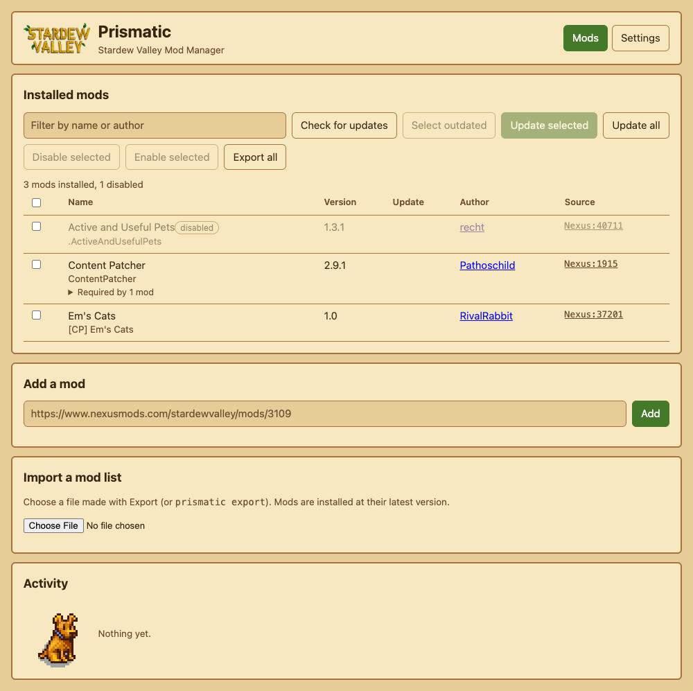

# Prismatic
A CLI tool and a web interface for installing, updating and managing Stardew Valley mods.



## Installation
Download the archive for your platform from the
[releases page](https://github.com/GestaltCaius/Prismatic/releases), unpack it and put `prismatic` somewhere on your `PATH`.

Or build it with Rust: `cargo install --git https://github.com/GestaltCaius/Prismatic`

On macOS a downloaded binary is quarantined, run `xattr -d com.apple.quarantine ./prismatic` once.

## Quick start
```bash
# Open the web interface: it starts a small server on your machine and opens your browser
prismatic

# Or stay in the terminal
prismatic list      # what is installed
prismatic update    # update everything that has a newer version
```
Prismatic finds your `Mods` folder by itself when Stardew Valley is installed in a usual Steam or GOG place
(see [Where the Mods folder is](#where-the-mods-folder-is)). Downloads from Nexus Mods need you to be signed in,
see [Nexus Mods](#nexus-mods).

## Using the command line
Every command works on the mods folder it finds, or on the one you give with `-d`. The `-d` option goes
*before* the command.

### See what is installed
```bash
prismatic list
```
```text
Em's Cats ([CP] Em's Cats)
Fifteen cat colour options.
Author: RivalRabbit
Version: 1.0
Source: Nexus

Content Patcher (ContentPatcher)
Loads content packs which edit game data, images, and maps without changing the game files.
Author: Pathoschild
Version: 2.9.1
Source: Nexus

Active and Useful Pets (.ActiveAndUsefulPets) [disabled]
Vanilla-friendly pet progression and utility overhaul for Stardew Valley 1.6+ pets.
Author: recht
Version: 1.3.1
Source: Nexus

3 mods found (1 disabled)
```
The name in brackets is the mod's folder. A dot in front of it means the mod is disabled.

### Update your mods
```bash
prismatic update            # checks which mods have a newer version and updates only those
prismatic update --force    # skips the check and updates every mod that has a source
```
The old version of each updated mod is kept in a `.old` folder inside the mods folder.

### Install a mod from Nexus Mods
```bash
prismatic add https://www.nexusmods.com/stardewvalley/mods/3109
```
If the mod needs mods you do not have, Prismatic lists them and asks which to install. Everything starts selected,
space toggles a mod and enter confirms.

### Turn a mod off and on
```bash
prismatic disable "Content Patcher"
# Content Patcher: disabled
# also disabled: Em's Cats

prismatic enable "Em's Cats"
# Em's Cats: enabled
# also enabled: Content Patcher
```
Give a name, a folder or a unique ID, as `list` shows them, and put quotes around anything with a space.
Mods that need a disabled mod are disabled with it, and enabling a mod enables what it needs.

### Back up or share your mod list
```bash
prismatic export                         # asks which mods to include, writes prismatic-mods.json
prismatic export --all my-mods.json      # no questions, writes my-mods.json
prismatic import prismatic-mods.json     # asks which mods to install, then installs them
prismatic import prismatic-mods.json --all
```
To play co-op with the same mods, export on one machine and send the file to your friends, who run `prismatic import`.

### Use another mods folder
```bash
prismatic -d "D:\SteamLibrary\steamapps\common\Stardew Valley\Mods" list
prismatic -d ~/games/stardew/Mods update
```

### Start the web interface differently
```bash
prismatic ui --no-open          # only print the address, do not open a browser
prismatic ui --port 8080        # another port (47821 by default, a free one is used if it is taken)
prismatic -d <dir> ui           # a mods folder that is not the usual one
```

## Using the web interface
Running `prismatic` with no command (or double-clicking it on Windows) starts a small server on your own machine and
opens it in your browser. It can list installed mods, check for and install updates, add a mod from a Nexus page,
disable and enable mods, and export or import mod lists, with the same checks the commands use. Authors link to
their Nexus profile. Stop it with Ctrl+C.

- **Disable and enable.** Select mods and press the button. The page lists the other mods that change with them and asks first.
- **Missing dependencies.** Mods that enabled mods need but that are not installed are listed in a "Missing dependencies" panel.
  They are installed from Nexus Mods when SMAPI's database knows their page, otherwise they are named so you can install them yourself.
- **Mods folder.** If none is found the page asks for one, and the "Mods folder" panel on the Settings tab can change it at any time
  (not while a job runs). Type the full path, `~` stands for your home folder. The choice is remembered in the browser and used the
  next time, unless the program is started with `-d`, which always wins. The page can install into any existing folder you give it,
  like the commands can with `-d`.
- **Nexus cookie.** Paste it once on the Settings tab, it is kept in your browser.

The server only listens on `127.0.0.1`, and every request needs the random token that is part of the printed address,
which stops other websites from using it to install mods on your machine.

## Nexus Mods
Nexus downloads use your `nexusmods_session` cookie, so you must be signed in to Nexus.
Treat the cookie like a password.

Either sign in to Nexus in your browser and Prismatic reads the cookie from it,
or set the `NEXUS_COOKIE` environment variable to the cookie's value (or the whole cookie string).
To find the value, open nexusmods.com while signed in, then in the browser's developer tools go to
Application (Chrome) or Storage (Firefox), Cookies, `nexusmods_session`.

```bash
# macOS and Linux
NEXUS_COOKIE=<value> prismatic update

# Windows PowerShell
$env:NEXUS_COOKIE="<value>"; prismatic update
```

## Reference

### Commands
| Command | What it does |
|---|---|
| `prismatic` or `prismatic ui` | Opens the [web interface](#using-the-web-interface) |
| `prismatic list` | Lists installed mods |
| `prismatic add <nexus url>` | Installs a mod from a Nexus Mods page, e.g. `https://www.nexusmods.com/stardewvalley/mods/3109` |
| `prismatic disable <mod>...` | Makes SMAPI ignore mods (names, folders or unique IDs as `list` shows them), and the mods that need them |
| `prismatic enable <mod>...` | Undoes `disable`, and also enables the mods they need |
| `prismatic update` | Updates installed mods if needed (`--force` skips the check) |
| `prismatic export [file]` | Writes your mod list to `prismatic-mods.json` (or `file`) |
| `prismatic import <file>` | Installs the mods listed in a file made by `export` |

`export` and `import` ask which mods to include (space toggles, enter confirms, everything starts selected).
Pass `--all` to skip the question, which is also what happens when there is no terminal.

The exit code is 0 on success and 1 on any error, or when an update or import could not do all it was asked to.
Mods without a usable update source are reported by `update` but don't count as failures.
A mod whose `manifest.json` can't be read is skipped with a warning, the others still work.

### Where the Mods folder is
Without `-d`, the first of these folders that exists is used (Steam first, then GOG):

| System | Locations, relative to your home folder unless absolute |
|---|---|
| Linux | `.steam/steam/steamapps/common/Stardew Valley/Mods`, `.local/share/Steam/steamapps/common/Stardew Valley/Mods`, `.var/app/com.valvesoftware.Steam/.local/share/Steam/steamapps/common/Stardew Valley/Mods` (Flatpak), `GOG Games/Stardew Valley/game/Mods` |
| macOS | `Library/Application Support/Steam/steamapps/common/Stardew Valley/Contents/MacOS/Mods`, `/Applications/Stardew Valley.app/Contents/MacOS/Mods` |
| Windows | `C:\Program Files (x86)\Steam\steamapps\common\Stardew Valley\Mods`, the same under `C:\Program Files\Steam`, `C:\Program Files (x86)\GOG Galaxy\Games\Stardew Valley\Mods`, `C:\GOG Games\Stardew Valley\Mods` |

If Stardew Valley is installed somewhere else (a second Steam library, say) specify the folder with `-d <dir>`.

### The mod list file
The file written by `export` holds each mod's name, version, `UniqueID` and every update key its manifest declares
(e.g. `Nexus:3109`, `GitHub:owner/repo`), never any credentials.
Some manifests have no usable Nexus id (e.g. `Nexus:???`), for those export asks SMAPI's mod database (smapi.io) for it,
which needs an internet connection. Files from older versions (format 1) can still be imported.
Import always installs the latest version of each mod, so friends can end up on a newer version than the host.
Only Nexus mods can be installed for now, entries from other sources are reported as failed and skipped.
Mods without an update key can't be exported.

### Config files
Currently only files or directories named `config` or `config.json` are copied when updating.
When updating the mod's directory is moved into `.old` in the mods directory and is otherwise untouched,
if some config files aren't automatically copied they can manually be copied from there.

## How it works

**Disabling a mod.** Prismatic puts a dot in front of the mod's folder name (`.MyMod`), which SMAPI ignores on every
platform. Disabling a mod also disables the enabled mods that need it, and enabling one also enables the disabled mods
it needs (from the `Dependencies` and `ContentPackFor` of their manifests). Disabled mods are skipped by updates.

**Missing dependencies.** `add` and `import` offer the mods that the mods they just installed need and that are not
installed, in a picker where everything starts selected. Without a terminal the commands only list them.

**Update sources.** Mods whose manifest has no usable update key (or a placeholder such as `Nexus:???`) are looked up on
SMAPI's mod database by their `UniqueID`, so `update` and the web interface can often still update them. A mod SMAPI
doesn't know takes the source its siblings agree on (same pack folder, same author in the `UniqueID`). Mods of one pack
share a download, and updating one of them replaces the whole pack folder.

## Design decisions
Why things are built the way they are is written down in [`docs/adr`](docs/adr/README.md).

## Security

Release binaries are built with [cargo-auditable](https://github.com/rust-secure-code/cargo-auditable), so the list of crates
inside them can be scanned for known vulnerabilities, for example with `osv-scanner scan source --x-plugins rust/cargoauditable -r <folder>`,
Trivy or Grype. Each release also carries a CycloneDX SBOM (`*.cdx.json`) and `SHA256SUMS`. The release workflow scans the binaries
and the SBOM first and does not publish if they have a known vulnerability. Pull requests run `cargo-deny` and OSV-Scanner on `Cargo.lock`.
To report a vulnerability, see [SECURITY.md](SECURITY.md).
